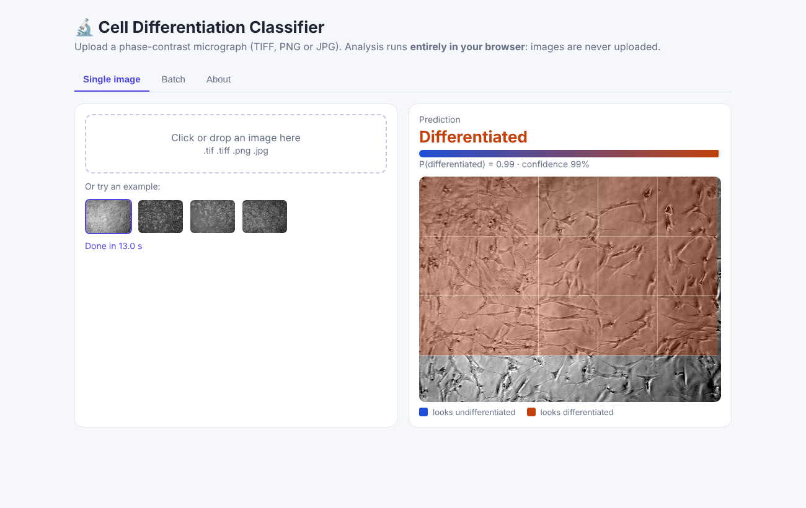
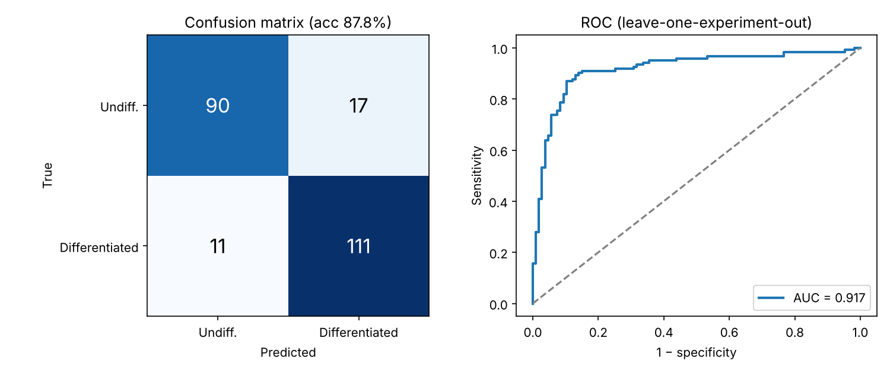

# 🔬 Cell Differentiation Classifier

Machine-learning model that classifies **phase-contrast micrographs** as **differentiated** or **undifferentiated**,
with a web interface (single image + batch mode) and a tile-level heatmap showing which regions drive the decision.

## 🌐 Live demo: https://shahdalqawasmi1-ui.github.io/Cell_Classifier/

The demo runs **entirely in the browser** (ONNX Runtime Web), so images never leave the user's device.
It works on desktop and mobile; the first visit downloads the model (~85 MB).
Browser predictions match the Python model (difference < 0.001).



## Pilot results

Validated with **leave-one-experiment-out** cross-validation: the model is always tested on an experiment
(culture batch / imaging day) it never saw during training, so there is no batch leakage.

| Metric | Value (95% bootstrap CI) |
|---|---|
| Accuracy | **87.8%** (83.4–91.7) |
| AUC | **0.917** (0.874–0.953) |
| Sensitivity (differentiated) | 91.0% |
| Specificity (undifferentiated) | 84.1% |



Per experiment, accuracy ranged from 82% to 92% and AUC from 0.90 to 0.99 (`results/per_experiment_results.csv`).
Errors follow biology:
- Cells given 10 µM retinoic acid were all classified correctly; at 1 µM, 81% were.
- Controls kept in 1% FBS or exposed to phorbol ester were misclassified most often. Both conditions start
  SH-SY5Y differentiation on their own.

## Data

[Yordanov & Hristiva — *Phase-contrast image dataset for morphological evaluation of SH-SY5Y differentiation after
rosmarinic and retinoic acid treatments*, Zenodo 19634700 (CC-BY 4.0)](https://zenodo.org/records/19634700).

- Differentiated: retinoic-acid treated, 1–10 µM (n = 122)
- Undifferentiated: untreated controls (n = 107)
- 4 independent experiment dates, FBS 1% or 10%, 2592×1936 px, 10× phase contrast.
- The 4 images in `examples/` come from this dataset.

## Method

1. Contrast-stretch each image (0.5–99.5 percentile), split it into 512-px tiles, and resize the tiles to 224 px.
2. Pass each tile through a frozen self-supervised **DINOv2 ViT-S/14** backbone, averaging the embeddings of the
   tile and its horizontal flip.
3. Fit an L2-regularised logistic regression (C = 0.05) on the tile embeddings.
4. Take the image probability as the mean of its tile probabilities.

## Quick start

```bash
git clone https://github.com/shahdalqawasmi1-ui/Cell_Classifier.git
cd Cell_Classifier
pip install -r requirements.txt
python app.py                      # web interface at http://127.0.0.1:7860
python predict.py my_images/ --csv predictions.csv   # command line
```

The first run downloads the DINOv2 weights (~90 MB) from Hugging Face.

### Run it online for free (Hugging Face Spaces)
Create a new Space (SDK: **Gradio**) and upload the files of this repository. The header at the top of this
README already configures it. You get a public link that anyone can open in the browser.

## Retrain on your own images (e.g. MSC vs fibroblast)

Use `notebooks/Cell_Classifier_Colab.ipynb` on Google Colab (GPU). Organise the images like this:

```
cell_data/
├── MSC/          donor1/ donor2/ donor3/ …
└── Fibroblast/   line1/  line2/  line3/  …
```

The second-level folders (donor or experiment) keep the train/test split free of leakage.
`scripts/train_eval.py` reproduces the pilot model above.

## Repository layout

```
docs/                   browser app (GitHub Pages): index.html + ONNX model + head.json
app.py                  Gradio web interface
predict.py              command-line batch prediction
cellclf/core.py         preprocessing + inference
model/                  trained classifier (logistic regression head)
scripts/fetch.py        downloads the pilot images from Zenodo
scripts/train_eval.py   feature extraction, cross-validation, figures, final model
notebooks/              Colab notebook for fine-tuning on new datasets
results/                metrics, per-image predictions, figures
examples/               sample images (CC-BY 4.0, Zenodo 19634700)
```

## Limitations

This is a pilot model, trained on one cell line, one microscope and one magnification. It is not validated for
MSCs, other cell types or other imaging settings: retrain it on lab-specific images before research use.
It is not intended for clinical or diagnostic use.

## License

Code: MIT. Example images: CC-BY 4.0 (Yordanov & Hristiva, Zenodo 19634700).
